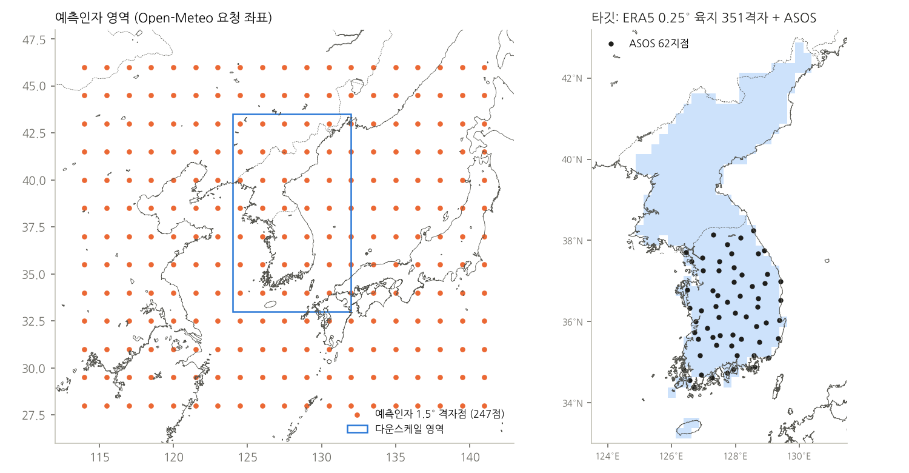
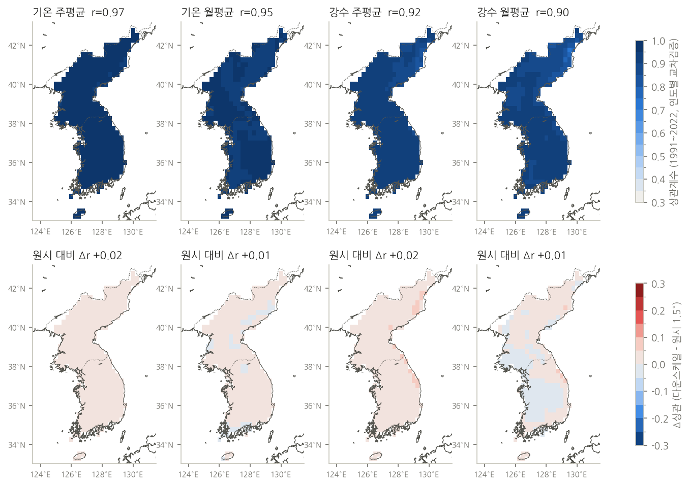
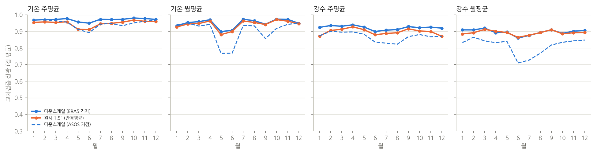
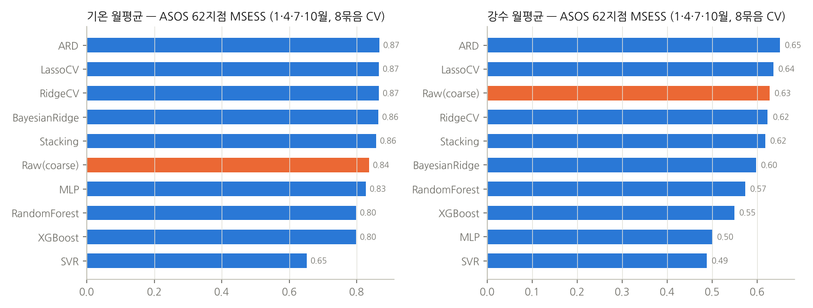
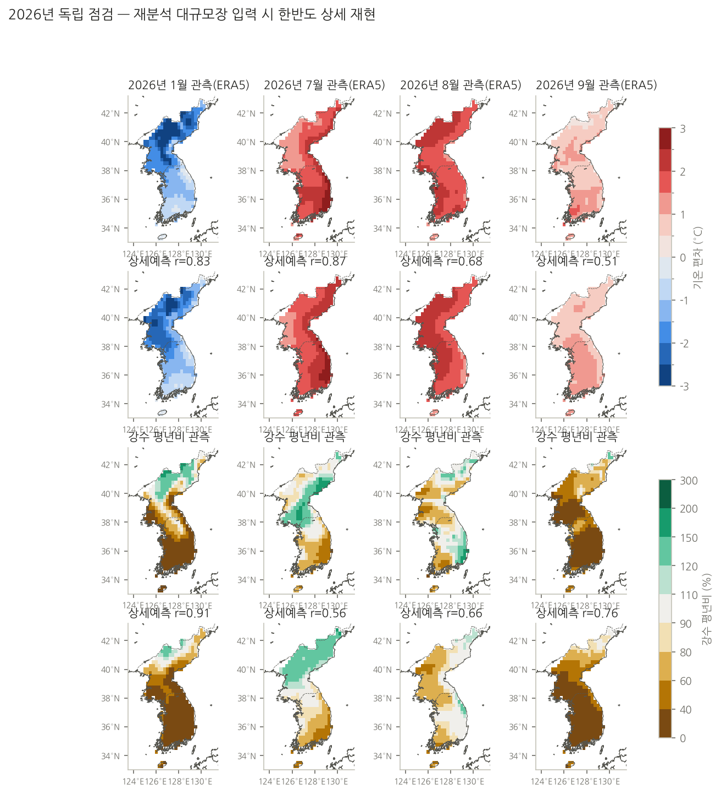

# 한반도 상세예측: PyESD 방식 통계 다운스케일링

EC46(주 1~6주)·SEAS5(월 1~6개월) 51개 멤버를 **한반도 0.25° 육지 351격자(북한 포함)**와 **ASOS 62지점**의 기온·강수로 상세화합니다.
[PyESD](https://github.com/Dan-Boat/PyESD)(Boateng & Mutz, 경험적 통계 다운스케일링)의 Perfect-Prognosis 구성을 따랐고,
PyESD 1.0.7은 scikit-learn 1.9와 맞지 않아(ARD `n_iter` 등) 같은 구성요소를 직접 구현했습니다.

## 방법

| 단계 | PyESD | 여기 |
|---|---|---|
| 예측인자 | 지점 반경 평균(`RegionalAverage`) + EOF 원격상관지수(NAO·EA·SCAN·MEI) | ERA5 1.5° **점표본** 247점(28–46N, 114–141E)의 기온·이슬점·해면기압·강수. 변수별 EOF 주성분(주 6개, 월 3개) + 대상점 반경 250 km 가우스 평균 |
| 표준화 | `MonthlyStandardizer` | 1991–2020 일별 조화함수(4개) 기후값 제거, 월 단위는 달별 평균 |
| 인자선택·회귀 | RFE·트리·순차선택, Ridge/Lasso/ARD/RF/XGBoost/MLP/SVR/Stacking | 점별 능형회귀(열 표준화, α는 연도 5묶음 CV로 점별 선택), 달별 모형(±1개월 창) |
| 강수 | 변환 선택 | sqrt 공간에서 적합, 멤버별 역변환 |
| 검증 | `cross_validate_and_predict` | 1991–2022 leave-one-year-out(EOF도 폴드마다 재계산), 2023–2026 독립검증 |
| 확률 | — | 멤버별 회귀 예측 + 교차검증 잔차 σ 정규혼합 → 3분위(1991–2020) 확률 |

- **지상변수만 쓰는 이유:** Open-Meteo 계절예보 API는 기압면 변수를 주지 않습니다. 학습(ERA5)과 예보 모두 같은 좌표의 점값을 씁니다.
- **모델 계통오차:** Open-Meteo 원자료는 보정되지 않았으므로, `pipeline/outlook.py`와 같은 방식으로 ECMWF 주·월 편차(재예측 기후 기준)로 모델 평년값을 역산한 뒤 ERA5 평년에 맞춥니다(기온·이슬점·해면기압 가법, 강수 승법). 편차 변수가 없으면 보정을 생략하고 `bias` 항목에 `none`으로 남깁니다.
- **타깃:** ERA5 0.25° 매시간(ECMWF ARCO) → KST 일평균 기온·일강수량. 북한은 관측이 없어 ERA5 격자를 타깃으로 하고, 남한은 ASOS 62지점도 따로 학습합니다.

## 검증 (다운스케일링 기술: 재분석 대규모장을 넣었을 때)

예보 기술이 아니라 "대규모장이 맞으면 상세값을 얼마나 재현하는가"입니다. 예보 기술은 여기에 EC46·SEAS5 자체 기술이 곱해집니다.

| 대상 | 변수 | 단위 | CV 상관 (1991–2022) | CV MSESS | 원시 1.5° MSESS | 독립 2023–26 상관 |
|---|---|---|---|---|---|---|
| 격자 | 기온 | 주 | 0.97 | 0.94 | 0.87 | 0.97 |
| 격자 | 기온 | 월 | 0.95 | 0.90 | 0.87 | 0.95 |
| 격자 | 강수 | 주 | 0.92 | 0.85 | 0.79 | 0.92 |
| 격자 | 강수 | 월 | 0.90 | 0.80 | 0.77 | 0.88 |
| ASOS | 기온 | 주 | 0.95 | 0.90 | 0.82 | 0.97 |
| ASOS | 기온 | 월 | 0.90 | 0.82 | 0.80 | 0.94 |
| ASOS | 강수 | 주 | 0.87 | 0.75 | 0.69 | 0.86 |
| ASOS | 강수 | 월 | 0.81 | 0.66 | 0.63 | 0.79 |

(달별로 계산한 점별 값의 평균. 전체 표: [docs/skill_summary.csv](docs/skill_summary.csv))

PyESD 회귀모형 비교(ASOS 16지점, 월평균, 1·4·7·10월, 8묶음 CV): 선형모형(ARD MSESS 기온 0.87·강수 0.65, Ridge 0.87·0.62)이 가장 좋고,
RandomForest(0.80·0.57)·XGBoost(0.80·0.55)·MLP·SVR은 표본(약 96개월)이 적어 과적합으로 오히려 낮습니다 → 운영은 능형회귀. [docs/model_comparison_asos_month.csv](docs/model_comparison_asos_month.csv)

| | |
|---|---|
|  |  |
|  |  |



## 운영 실행

```bash
pip install -r downscaling/requirements.txt
python downscaling/forecast.py --maps            # Open-Meteo EC46·SEAS5 → site/data/latest/downscaling/
python downscaling/forecast.py --demo --maps     # 네트워크 없이 합성 자료로 시험
```

산출 (`site/data/latest/downscaling/`)
- `downscaling.json`: 격자·지점 좌표, 기간별 편차·값·3분위 확률·교차검증 상관, 계통오차 보정량
- `asos62_downscaled.csv`: ASOS 62지점 주·월 기온·강수 예측표
- `map_week.png`, `map_month.png`: 기온 편차·우세범주, 강수 평년비·우세범주 지도

GitHub Actions 「객관기후예측 갱신」에서 기존 산출 다음에 실행됩니다(실패해도 기존 전망 게시는 계속).

## 재학습 (`train/`)

```bash
pip install -r downscaling/train/requirements-train.txt
cd downscaling/train && export KDS_RAW=work/raw KDS_WORK=work OMP_NUM_THREADS=1
CDSAPI_KEY=... python get_era5_kor.py      # 한반도 0.25° 타깃 (ARCO geoChunked, 약 2분)
CDSAPI_KEY=... python get_era5_pred.py     # 1.5° 예측인자 (약 6분)
KMA_AUTHKEY=... python get_asos.py         # ASOS 62지점 1991~
python prep.py && python train.py          # 학습·교차검증 (격자 주 단위가 가장 오래 걸림, 약 25분)
python compare_models.py && python make_figs.py
python export_models.py ../models          # 운영용 계수 (.npz, 약 10 MB)
```
인증키는 환경변수로만 넘기고 파일에 저장하지 않습니다. 최종 모형 학습기간 1991–2025, 평년 1991–2020.
